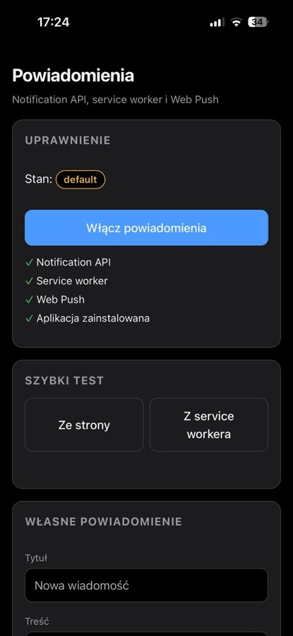
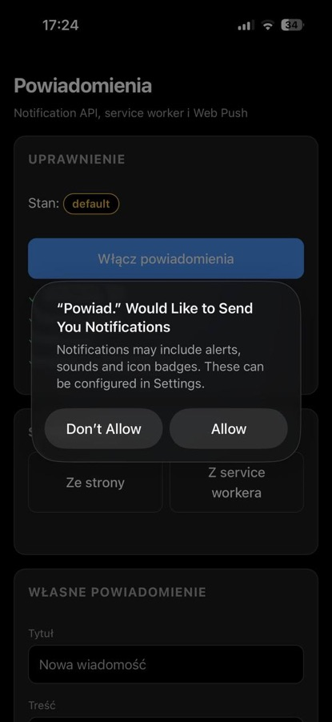
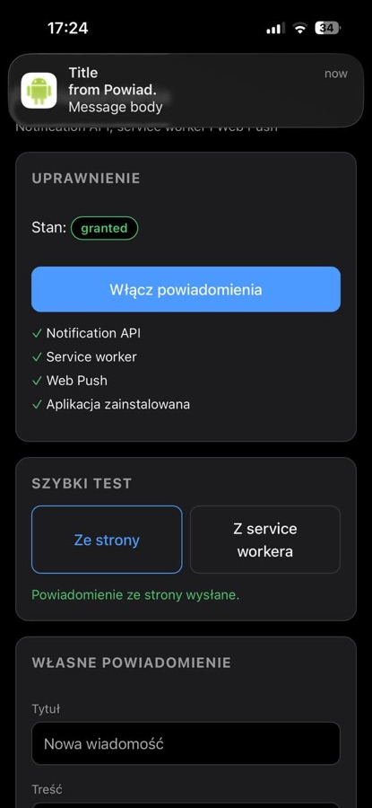
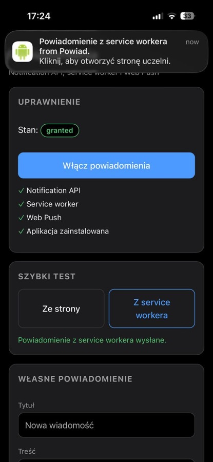
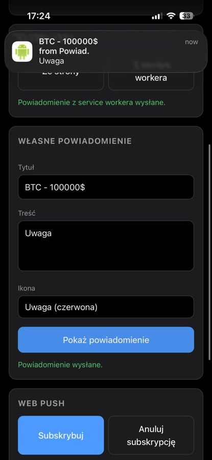
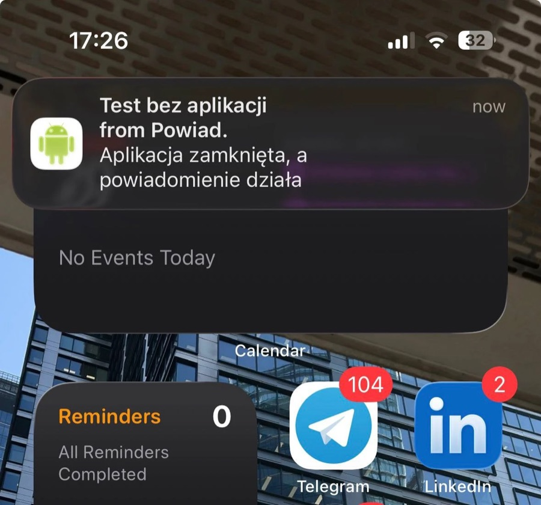

# Lab 02 – Powiadomienia i Web Push

Aplikacja: https://pwa-lab-02.web.app

## Funkcje

- zgoda na powiadomienia po kliknięciu przycisku, stan uprawnienia widoczny na stronie,
- powiadomienie ze strony (`new Notification`) i z service workera (`showNotification`),
- formularz: tytuł, treść, wybór ikony z trzech (`android.png`, `alert.png`, `info.png`);
  pusty tytuł blokuje walidacja,
- kliknięcie w powiadomienie przywołuje okno aplikacji albo otwiera nowe,
- Web Push: subskrypcja, anulowanie, powiadomienie z `send-push.mjs` przy zamkniętej aplikacji,
- lista obsługiwanych API w danej przeglądarce.

## Struktura

```
lab_02/
├── public/              ← publikowane na Firebase
│   ├── icons/
│   ├── alert.png, android.png, info.png
│   ├── index.html
│   ├── manifest.json
│   ├── notification.js
│   ├── service-worker.js
│   └── styles.css
├── generate-keys.mjs
├── send-push.mjs
├── firebase.json
└── package.json
```

`vapid-keys.json` i `subscription.json` są w `.gitignore`.

## Uruchomienie

```bash
cd public && npx serve        # terminal 1
npm install                   # terminal 2, folder lab_02
node generate-keys.mjs        # klucze VAPID, klucz publiczny wklej do public/notification.js
```

Po kliknięciu **Subskrybuj** wklej subskrypcję do `subscription.json`, potem:

```bash
node send-push.mjs "Nowa wiadomość" "Pozdrowienia z serwera!"
```

Publikacja:

```bash
npx firebase-tools deploy --only hosting --project pwa-lab-02
```

## Przeglądarki

- iOS 16.4+: w karcie Safari obiekt `Notification` nie istnieje, powiadomienia działają dopiero
  po dodaniu aplikacji do ekranu początkowego,
- Safari ignoruje opcję `icon` i pokazuje ikonę aplikacji; wybór ikony widać w Chrome i na Androidzie,
- Chrome na Androidzie nie obsługuje `new Notification()`.

## Zrzuty ekranu

Aplikacja zainstalowana na iPhonie i prośba o zgodę:

<p>
  
  
</p>

Powiadomienie ze strony, z service workera i z formularza:

<p>
  
  
  
</p>

Web Push przy zamkniętej aplikacji:


