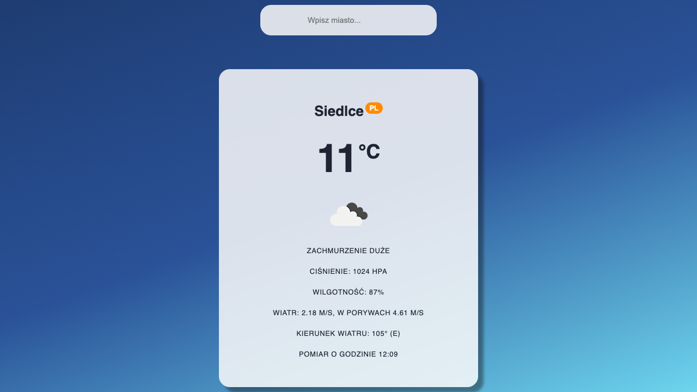
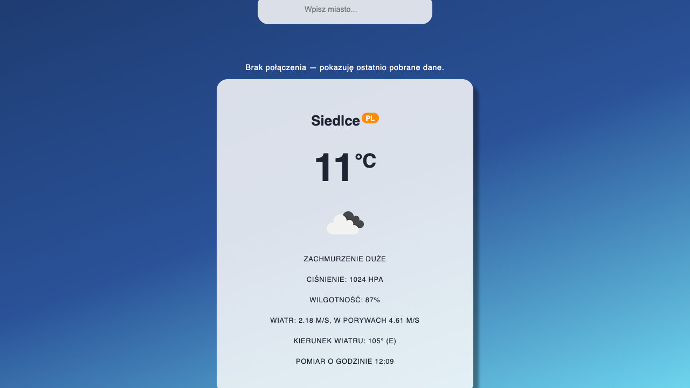
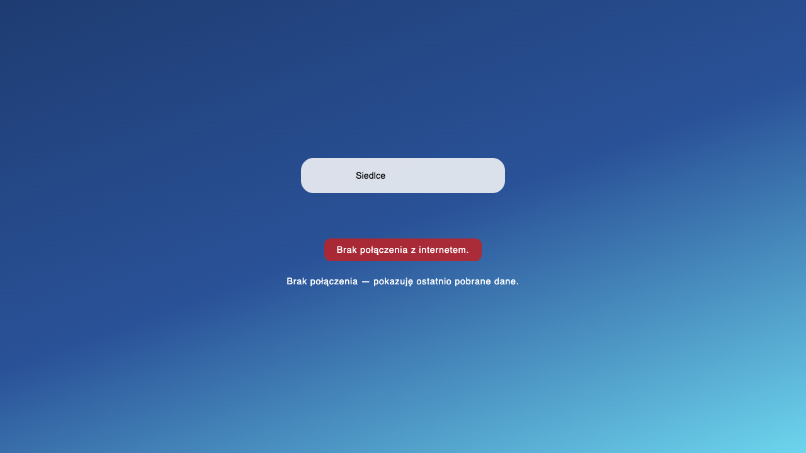
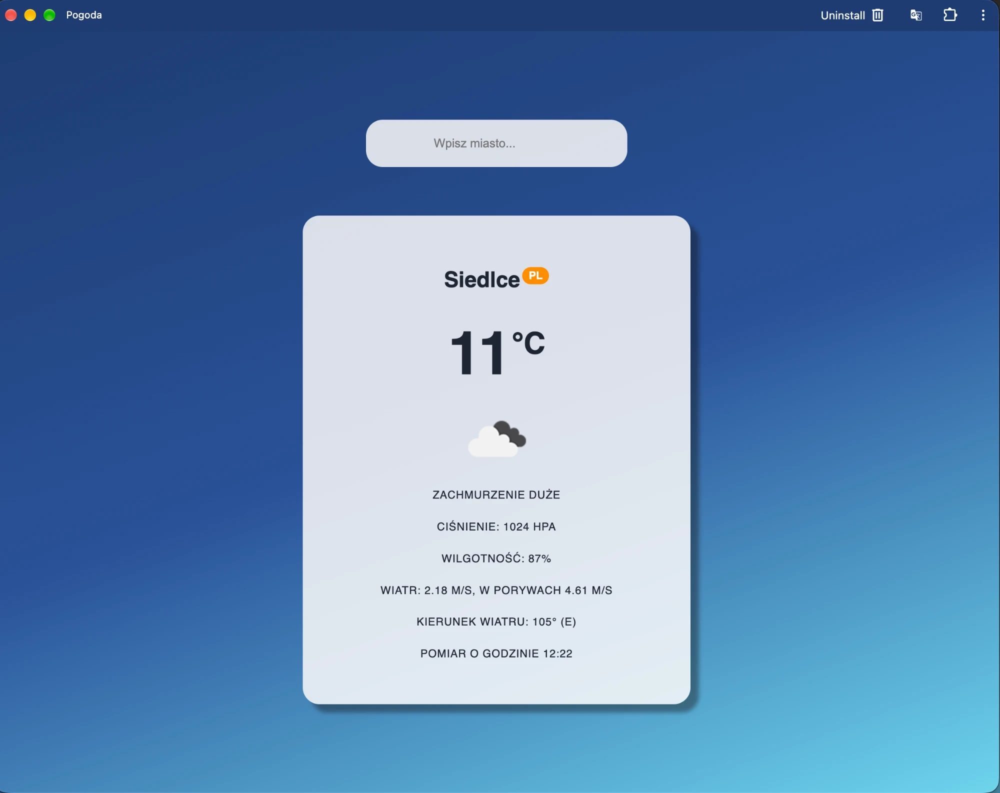

# lab_03 — Pogoda (PWA)

Aplikacja React (Vite) pobiera pogodę z OpenWeatherMap i działa offline (cache `NetworkFirst`).

## Uruchomienie

```bash
npm install
npm run build
npm run preview
```

http://localhost:4173/

Tryb deweloperski (bez service workera): `npm run dev` → http://localhost:5173/

Klucz API: `src/api/fetchWeather.js`, stała `API_KEY`.

## Zrzuty ekranu








