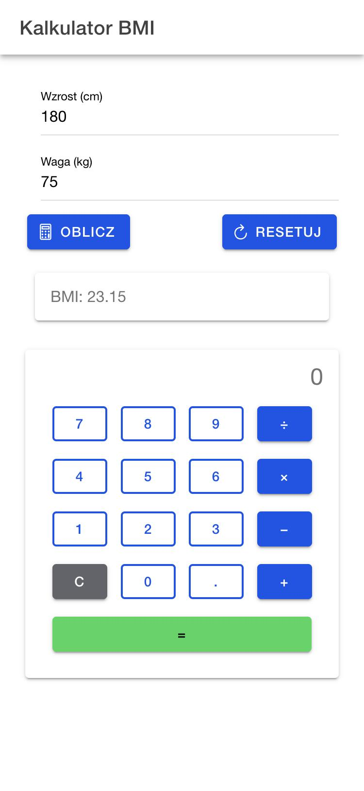

# lab_04 — Ionic React

Kalkulator BMI (zad. 1, 2) i kalkulator jako osobny komponent (zad. 3).

## Uruchomienie

```
npm install
ionic serve
```

http://localhost:8100 — bez Ionic CLI: `npm run dev`. Build: `npm run build`.

Widok telefonu: DevTools (F12) → Toggle device toolbar (Ctrl+Shift+M) → Mobile.
Styl iOS: http://localhost:8100/?ionic:mode=ios

## Struktura

- `src/App.tsx` — kalkulator BMI. Pola wzrostu i wagi (`IonInput` + `useRef`),
  przyciski Oblicz/Resetuj z ikonami, wynik w `IonCard` (`useState`).
- `src/components/Kalkulator.tsx` — kalkulator. Wyświetlacz w stanie,
  siatka 4 kolumn (`7 8 9 ÷ / 4 5 6 × / 1 2 3 − / C 0 . +` i `=`),
  działania przez `switch`, bez `eval()`.
- `src/theme/variables.css` — zmienne motywu.

## Zrzuty ekranu

180 cm, 75 kg → BMI 23.15:



`9 − 4 =`, potem `× 3 =` → 15:


