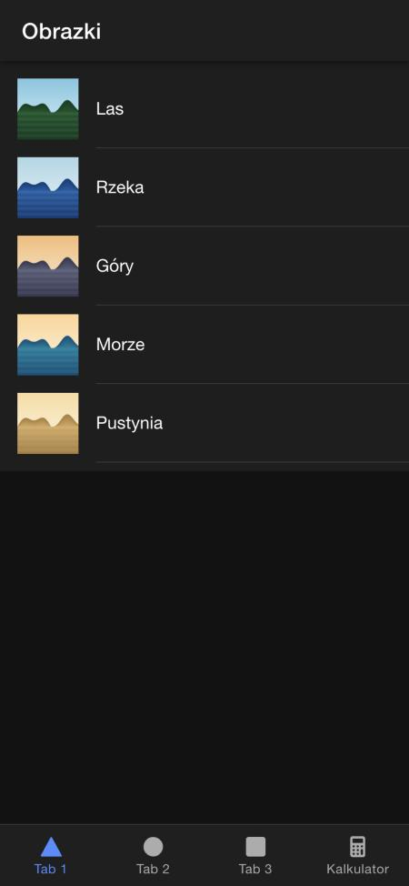
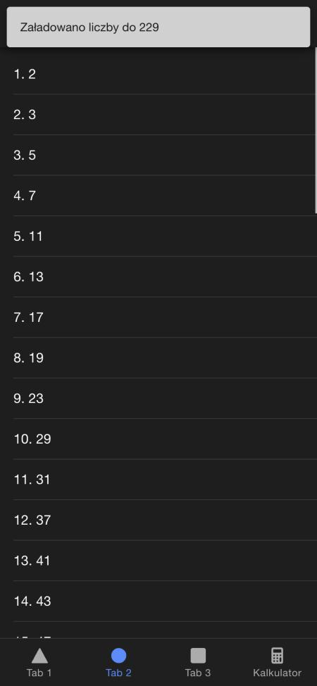
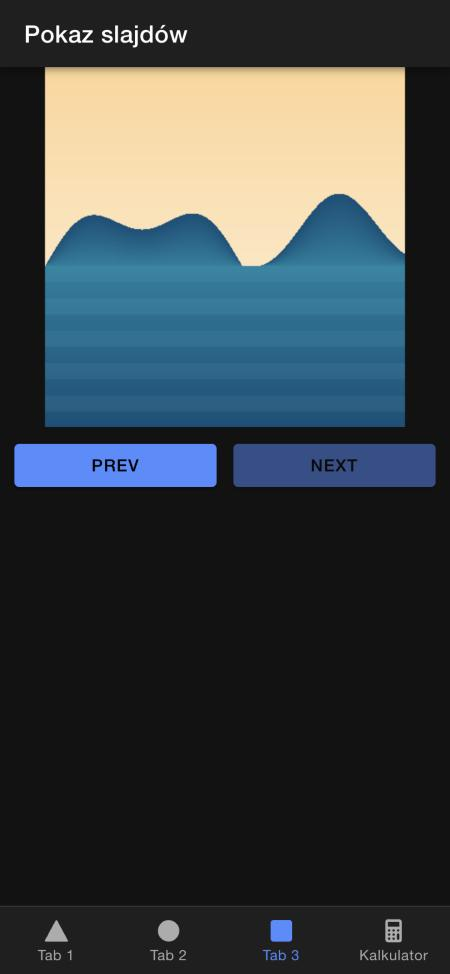
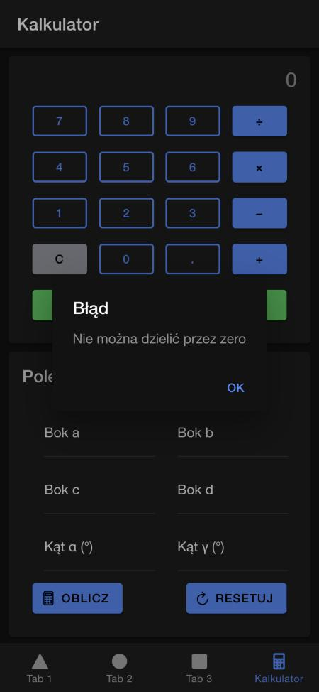
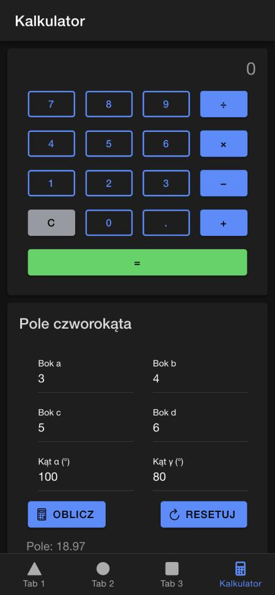

# lab_05 — Ionic React, podstawowe komponenty

Aplikacja z czterema zakładkami: lista obrazków, liczby pierwsze z infinite scroll,
pokaz slajdów (Swiper) i kalkulator z alertem (zad. 0–6).

## Uruchomienie

```
npm install
ionic serve
```

http://localhost:8100 — bez Ionic CLI: `npm run dev`. Build: `npm run build`.

Widok telefonu: DevTools (F12) → Toggle device toolbar (Ctrl+Shift+M) → Mobile.

## Struktura

- `src/App.tsx` — `IonTabs` z czterema trasami (`/tab1`…`/tab4`) w `IonRouterOutlet`
  i przyciskami `Tab 1`, `Tab 2`, `Tab 3`, `Kalkulator` w `IonTabBar`
  (ikony `triangle`, `ellipse`, `square`, `calculator`) — zad. 0.
- `src/pages/Tab1.tsx` — lista obrazków (zad. 3). Tablica `items` z typem `Item`,
  `IonList` budowana metodą `map`, miniatury w `IonThumbnail slot="start"`,
  obrazki z `public/img` z `loading="lazy"`.
- `src/pages/Tab2.tsx` — liczby pierwsze (zad. 4). Funkcje `czyPierwsza` i
  `kolejnePierwsze`, 30 liczb na start, `IonInfiniteScroll` dolicza po 20 kolejnych
  i pokazuje toast (`useIonToast`, `position: 'top'`).
- `src/pages/Tab3.tsx` — pokaz slajdów (zad. 5). `Swiper` + `SwiperSlide`,
  przyciski `PREV` / `NEXT` wyłączane przez `isBeginning` / `isEnd` w `slideChange`.
- `src/pages/Tab4.tsx` — zakładka `Kalkulator` (zad. 0, 1): komponent `Kalkulator`
  przeniesiony z `lab_04` i formularz pola czworokąta.
- `src/components/Kalkulator.tsx` — kalkulator; dzielenie przez zero czyści
  wyświetlacz i pokazuje `IonAlert` (zad. 2).
- `src/components/Czworokat.tsx` — pole czworokąta wypukłego ze wzoru Bretschneidera
  (zad. 6). Pola `IonInput type="number"` czytane przez `useRef`, stopnie zamieniane
  na radiany, wynik z dwoma miejscami po przecinku, komunikat przy złych danych.
- `public/img/` — obrazki do listy i do slajdów.

Sprawdzone: kwadrat o boku 1 i kątach 90° → `1.00`, prostokąt 3 × 4 → `12.00`,
boki 3, 4, 5, 6 i kąty 100°/80° → `18.97`, boki 1, 1, 1, 10 → „Taki czworokąt nie istnieje”.

## Zrzuty ekranu

Lista obrazków (zakładka Tab 1):



Liczby pierwsze — po doładowaniu kolejnej porcji, z komunikatem toast (zakładka Tab 2):



Pokaz slajdów — ostatni slajd, `NEXT` wyłączony (zakładka Tab 3):



Kalkulator, `7 ÷ 0 =` → alert (zakładka Kalkulator):



Pole czworokąta: boki 3, 4, 5, 6 i kąty 100°, 80° → 18,97:


