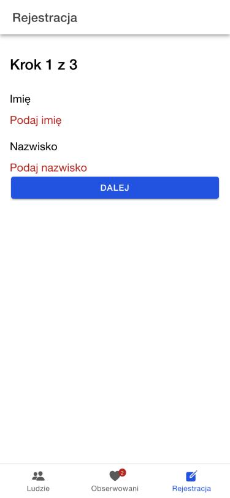
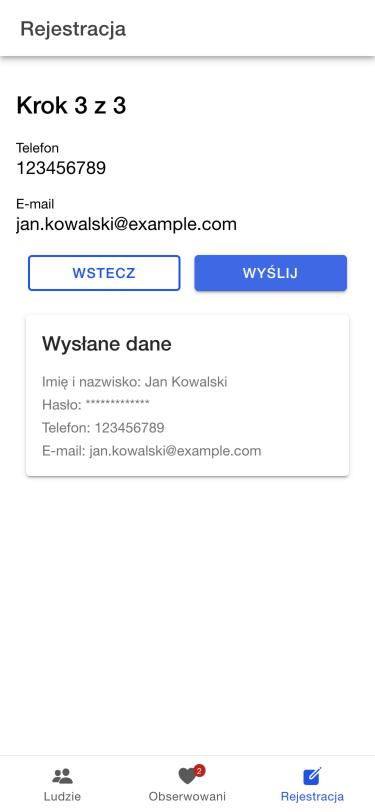

# lab_06. Nawigacja, wspólny stan i formularze (Ionic React)

Trzy zakładki: **Ludzie** (lista osób, przycisk Obserwuj, pull-to-refresh),
**Obserwowani** (tylko obserwowane osoby), **Rejestracja** (formularz w trzech
krokach z walidacją). Dane trzyma store Zustand, więc obie listy widzą tę samą
tablicę. Zadania 1-5 plus dwa dla chętnych.

## Uruchomienie

```
npm install
ionic serve
```

Bez Ionic CLI: `npm run dev`. Aplikacja startuje na http://localhost:8100.
Widok telefonu: F12, potem Toggle device toolbar (Ctrl+Shift+M).

## Pliki

| Plik | Co robi | Zadanie |
| --- | --- | --- |
| `src/data/people.ts` | typ `Person`, cztery osoby startowe, awatary z `i.pravatar.cc` | 1 |
| `src/store/peopleStore.ts` | store Zustand: `people`, `toggleFollowing`, `addPerson` | 1, 3 |
| `src/components/PersonItem.tsx` | wiersz listy: awatar, przycisk Obserwuj, `routerLink` do szczegółów | 1, 2 |
| `src/pages/Tab1.tsx` | zakładka Ludzie, lista ze store, `IonRefresher` | 1, 3 |
| `src/pages/Tab2.tsx` | zakładka Obserwowani, `filter` po `following` | 1 |
| `src/pages/PersonDetail.tsx` | widok `/tab1/<id>`: `useParams`, `find`, `IonBackButton` | 2 |
| `src/pages/Tab3.tsx` | formularz na slajdach Swiper, `useForm`, karta z podsumowaniem | 4, 5 |
| `src/App.tsx` | `IonTabs`, trasy `/tab1`, `/tab1/:id`, `/tab2`, `/tab3`, `IonBadge` z licznikiem | 1, 2, chętni |

Trzy miejsca, w których łatwo się pomylić:

- Filtrowanie w Tab2 siedzi poza selektorem. `usePeopleStore((s) => s.people.filter(...))`
  zwraca nową tablicę przy każdym odczycie i aplikacja wpada w `Maximum update depth exceeded`.
- Przycisk Obserwuj leży wewnątrz `routerLink`, więc jego `onClick` woła
  `preventDefault()` i `stopPropagation()`. Inaczej każde kliknięcie otwiera szczegóły.
- `odswiez` kończy się na `event.detail.complete()`. Bez tego kółko kręci się bez końca.

## Walidacja

| Pole | Reguła | Komunikat |
| --- | --- | --- |
| Imię, Nazwisko | `required` | Podaj imię / Podaj nazwisko |
| Hasło | `required`, `minLength: 8` | Hasło musi mieć co najmniej 8 znaków |
| Telefon | `required`, `pattern: /^\d{9}$/` | Telefon musi mieć dokładnie 9 cyfr |
| E-mail | `required`, `pattern: /^\S+@\S+\.\S+$/` | Niepoprawny e-mail |

`mode: 'onChange'` sprawdza pole przy pisaniu, `trigger(pola)` przepuszcza na
następny slajd tylko poprawne kroki, `allowTouchMove={false}` blokuje
przeskakiwanie walidacji gestem. Po `Wyślij` dane idą do `console.log` i do
stanu `wyslane`, a `IonCard` pokazuje je z hasłem zamienionym na gwiazdki.

## Sprawdzone

- Obserwuj na zakładce Ludzie zmienia przycisk, dopisuje osobę na zakładce
  Obserwowani i podbija licznik w pasku zakładek.
- Kliknięcie osoby otwiera `/tab1/3`, strzałka wraca do listy. `/tab1/99`
  pokazuje „Nie ma osoby o numerze 99”.
- Przeciągnięcie listy w dół dopisuje po sekundzie „Nowa Osoba 5” na górze.
  Po `F5` lista wraca do czterech osób startowych.
- Puste pola blokują `Dalej` i pokazują czerwone komunikaty. Hasło z 3 znaków
  i e-mail bez `@` nie przechodzą.
- `Wyślij` wypisuje dane w konsoli (F12) i pokazuje kartę „Wysłane dane”.

## Zrzuty ekranu

Lista osób i lista obserwowanych (zad. 1):


Szczegóły osoby (zad. 2) i lista po odświeżeniu (zad. 3):


Błędy walidacji (zad. 4) i karta z wysłanymi danymi (zad. 5):



